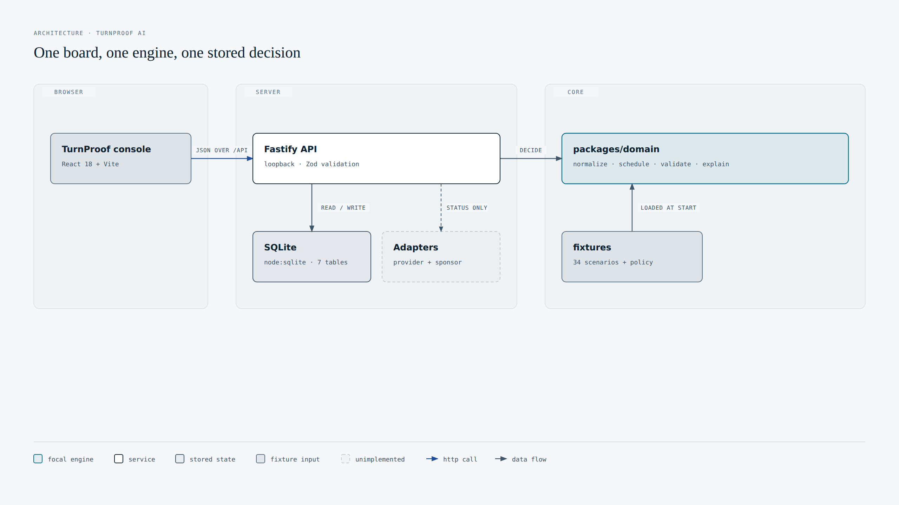
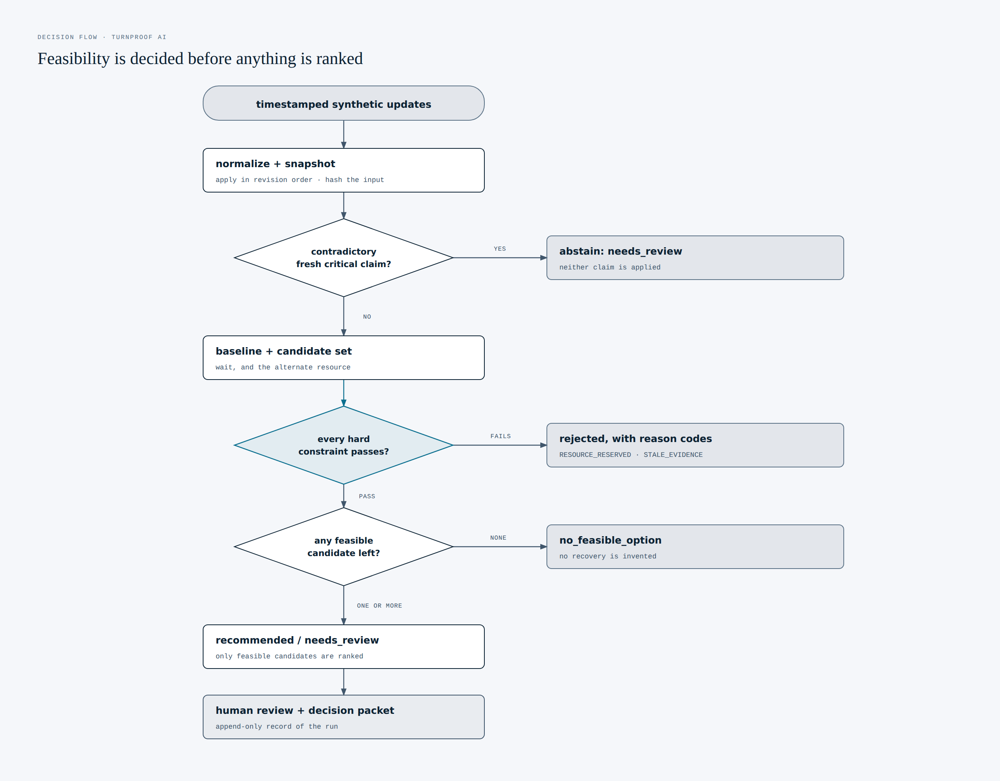
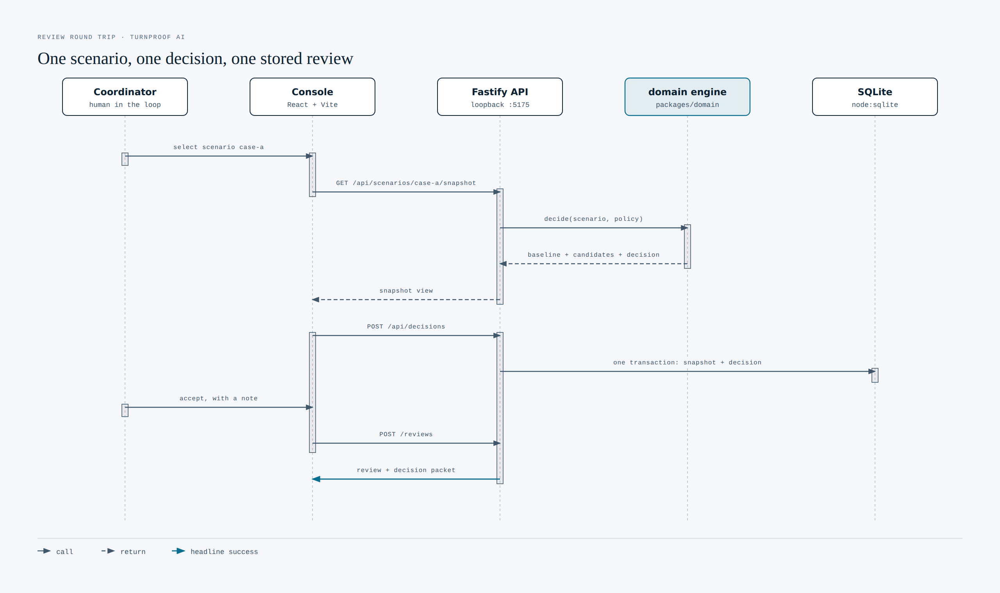

# TurnProof AI — Recover the turnaround. Show the evidence.


An evidence-backed turnaround recovery assistant for one station and one disrupted turnaround at a time. It turns timestamped ground-service updates into a dependency timeline, computes projected readiness, compares constraint-checked recovery options, and exports a cited decision packet for human review.

**Prototype — synthetic data — advisory only — no operational execution.**

**Repository:** <https://github.com/yablokolabs/turnproof-ai> (public, pushed 2026-10-12).

**Status: working offline prototype.** Measured results exist and are committed under `proof/`. A narrated demo video is committed at `proof/demo/turnproof-demo.mp4` (2:30, 1280x720): a scripted Playwright session over the real local API, voiced by ElevenLabs text to speech, not a person and not performed on camera. What does not exist: any live model provider integration, any sponsor integration, any pilot, any partner, any customer, and any interview.

## What works today

1. **Dependency scheduling.** A DAG of inspection, fueling, boarding and ready tasks, computed in topological order with stable id tie breaks, resource availability, exclusive reservations and verified actual times. Cycles and missing predecessor references are rejected.
2. **Constraint gating before ranking.** Every candidate passes hard checks on dependency validity, resource kind, exclusive availability, availability windows, duration bands, completed-task immutability, non-negative timing and critical evidence freshness. Failures produce explicit reason codes.
3. **Three end-to-end cases.** Case A recovers 15 minutes against waiting using an alternate synthetic tanker; Case B finds no feasible recovery and says so; Case C abstains when two fresh updates contradict each other.
4. **Human review and export.** Append-only review records in SQLite, and a decision packet download containing the snapshot, evidence, candidate set, constraints, both schedules, hashes and provenance.
5. **Honest provider modes.** `deterministic` rules by default, `replay` from stored decisions and always labelled, `live` reported unavailable.

## How it fits together

### Components

The domain package holds every rule. The UI never decides feasibility, and the API never schedules anything itself: it validates a request, calls the domain, and persists the result.



### Decision pipeline

Feasibility is decided before ranking, and an unresolved critical fact never reaches a recommendation. Every reject carries the reason codes that killed it.



### Review and export round trip

A decision must be persisted before it can be reviewed, which is why the console records one as soon as a scenario loads.



The three diagrams are generated from `docs/diagrams/*.html` by `npm run diagrams:build`, which rasterises each `<svg>` to a committed PNG and exports a standalone SVG beside it, and were authored against the design system in the community skill `cathrynlavery/diagram-design`, whose `export_svg.py` does the SVG extraction. Every diagram is a committed file, so the README renders without a server, a network fetch or a diagram runtime, and the vector versions sit beside the PNGs as `architecture.svg`, `decision-flow.svg` and `review-sequence.svg`. Only the SVG half of the build needs that skill (`npx skills add cathrynlavery/diagram-design --skill diagram-design --yes`); `npm run diagrams:build` builds the PNGs and says so if the skill is absent.

Those tokens are not the skill's default skin. Its brand palette was replaced with colours sampled from this project's own assets, and each diagram's source comment discloses that substitution.

## Run it

Node 22.5 or newer is required, because SQLite comes from the built-in `node:sqlite` module.

1. `npm install`
2. `npm run seed` — seeds the 34 committed synthetic scenarios into local SQLite
3. `npm run dev` — API on `http://127.0.0.1:4181`, UI on `http://127.0.0.1:5173`

Or run the built UI straight from the API on a single origin:

1. `npm run build:web`
2. `npm start` — then open `http://127.0.0.1:4181`

Node prints `ExperimentalWarning: SQLite is an experimental feature` on startup. That is expected: persistence uses the built-in `node:sqlite` module, chosen so `npm install` needs no native toolchain. See `docs/DECISIONS.md`.

## Verify it

| Command | What it does | Last result |
| --- | --- | --- |
| `npm test` | 45 Vitest tests: 16 engine, 14 hard-constraint and adverse, 15 API | all pass |
| `npm run test:e2e` | builds the UI, serves it from the API on loopback, runs 6 Playwright browser tests: 5 behaviour flows plus 1 screenshot capture into `proof/screenshots/` | all pass |
| `npm run typecheck` | TypeScript check across every workspace | exit 0 |
| `npm run evaluate` | decides 34 fixtures, writes `proof/results/evaluation.json` | 27 recommended, 3 abstained, 4 no feasible option |
| `npm run proof:export` | writes `proof/manifest.json` and the three decision packets, hashing every tracked artefact | manifest lists the artefact count, scenario count and bundle hash |
| `npm run proof:zip` | packages the bundle into `proof/turnproof-proof.zip` and records the archive hash in `proof/zip-manifest.json` | 146 entries, 16.1 MB; hash in `proof/zip-manifest.json` |
| `npm run diagrams:build` | rasterises `docs/diagrams/*.html` to the committed PNGs and exports a standalone SVG beside each | 3 diagrams, exact viewBox x2 pixel sizes |
| `npm run diagrams:check` | re-measures the exported diagrams: pixel size, text overlaps, labels off their masks, labels straddling a box edge, inset under 6px, diamond text overflowing | all 3 pass, 0 findings in each category |
| `npm run demo:narrate` | synthesises one narration MP3 per beat with ElevenLabs and writes the timing file. The only command that contacts a third party, and it needs `ELEVENLABS_API_KEY` in the environment | 7 beats, 2196 characters, 150.49 s, voice `Alice` |
| `npm run demo:video` | records one Chromium segment per beat, holds each to its narration length, muxes the narration, and rebuilds `proof/demo/turnproof-demo.mp4` | 1280x720 h264 + aac, 150.23 s, audio present |

The proof archive carries a fixed entry timestamp, so the same working tree produces the same bytes. It was verified independently rather than self-reported, with `python3 -c "import zipfile; z=zipfile.ZipFile('proof/turnproof-proof.zip'); print(len(z.namelist()), z.testzip())"`, which reported 146 entries and a clean CRC check, and Python's own sha256 of the file matched the value recorded in `proof/zip-manifest.json`. That value is kept outside the archive on purpose: the archive contains this README, so a hash pinned inside it could never stay valid. Rebuilding after any source change changes the hash, so treat it as a change detector, not as tamper-proof storage.

Measured on the committed fixtures: 125 source artefacts hashed in `proof/manifest.json`; 16 evidence ids cited with 0 unresolved; abstention correct on 2 of 2 conflicting-evidence scenarios and 4 of 4 no-feasible scenarios; projected recovery 150 minutes in total across 10 scenarios strictly better than waiting (17 equal, 0 worse); solver latency p50 0.201 ms, p95 1.112 ms on the latest run (this is solver runtime and it varies by run, so treat it as an order of magnitude rather than a benchmark). All 4 hand-derived hero oracles match, and reruns produce identical decision ids. Full detail, denominators and limits are in `docs/EVALUATION.md`.

Case A is an expected test oracle on synthetic durations 10/20/15/5 minutes, not a measured real-world saving.

## What it deliberately does not do

1. No flight release, dispatch, aircraft control, maintenance sign-off, crew legality assessment or passenger rebooking.
2. No write to any airline, handler or sponsor system. The only writes are to the prototype's own local SQLite file.
3. No live AI. `live` mode is reported as unavailable, and there is no stub client, simulated latency or hard-coded response anywhere.
4. No airline or airport data. Stations, flights, aircraft and ground units are fictitious, and the durations, cost units and freshness budgets are invented for the demo.
5. No operational authority. A recorded review is a reviewer's preference inside the prototype, never an authorization to act.

## Repository layout

```text
apps/web/src/{pages,components,api}      React + Vite console
apps/api/src/{routes,services,storage}   Fastify API, SQLite persistence
packages/domain/src/{schemas,normalize,schedule,candidates,validate,explain}
packages/adapters/src/{contracts,extract}
fixtures/{scenarios,policies}            34 committed synthetic scenarios, hashed
scripts/{seed,evaluate,proof-export,build-fixtures,generate-scenarios,dev}
scripts/{build-diagrams,check-diagrams,record-demo}
tests/{domain,api,e2e}
docs/{PROGRESS,INTEGRATIONS,EVALUATION,PILOT,DEMO,DECISIONS}.md
docs/diagrams/*.{html,svg,png}           diagram sources, vectors and committed renders
proof/{manifest.json,zip-manifest.json,turnproof-proof.zip,results,screenshots,packets}
proof/demo/                              scripted screen recording and its manifest
```

## Documentation

| File | Contents |
| --- | --- |
| `docs/EVALUATION.md` | measured results, method, denominators and every open gap |
| `docs/INTEGRATIONS.md` | what is integrated (nothing external), and what was never verified |
| `docs/PILOT.md` | the unsecured four-week read-only shadow pilot proposal |
| `docs/DECISIONS.md` | architecture decision record, including the bugs found and fixed |
| `docs/DEMO.md` | the three-minute demo script and shot list; unrecorded, the committed MP4 is a silent screen capture |
| `docs/diagrams/*.html` | the sources behind the three diagrams in this README |
| `docs/PROGRESS.md` | milestone checkpoints with commands, results and blockers |
| `PROJECT_BUILD.md` | the implementation specification this build follows |
| `AGENTS.md` | repository working rules |

## Safety and scope

Simulation and advisory decision support only. Hard constraints gate every candidate before ranking, and any unknown, stale or contradictory critical fact produces `needs_review` or an explicit `no_feasible_option` rather than a guess. Imported text is treated as untrusted data and never as an instruction. Credentials, if any are ever added, stay server-side and out of source, logs, exports and prompts.

## Timeline

Evidence lock October 23, 2026, without a stated time or timezone, so internal evidence completion is targeted for October 22. Final submission October 28, 2026 at 00:00 UTC, which is 05:30 IST the same day. The October 25 Boston event is a demonstration day, not a build day. These are deadlines from the supplied competition material, not milestones this project has already met.
